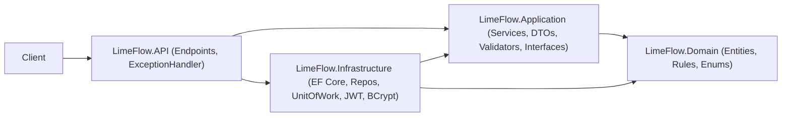
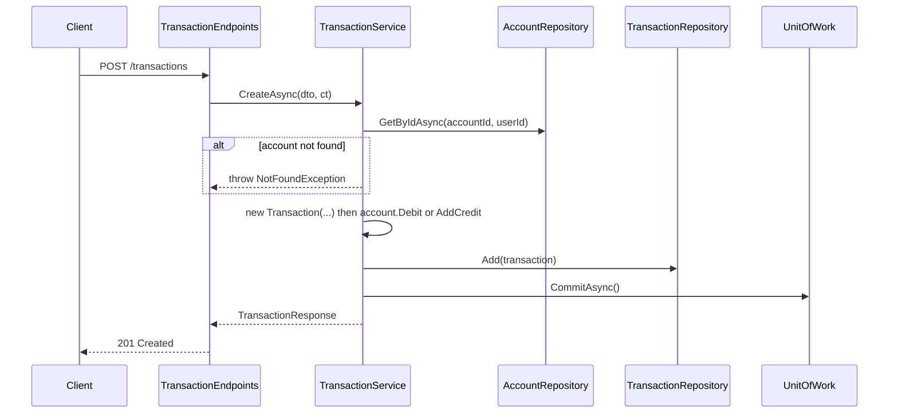

# LimeFlow Finances API

Personal finance API built with .NET 9, ASP.NET Core Minimal APIs, EF Core and PostgreSQL. Users manage bank accounts, categorize income and expenses, track budgets and savings goals, and see summary reports.

This README is both the **requirements specification** and the **implementation roadmap**. Work through the phases in order and tick the checkboxes as you go.

---

## Table of contents

1. [Getting started](#1-getting-started)
2. [Architecture](#2-architecture)
3. [Current state](#3-current-state)
4. [Known bugs and required fixes](#4-known-bugs-and-required-fixes)
5. [API conventions](#5-api-conventions)
6. [Domain requirements](#6-domain-requirements)
7. [Endpoint catalog](#7-endpoint-catalog)
8. [Roadmap](#8-roadmap)
9. [Testing requirements](#9-testing-requirements)
10. [Definition of done](#10-definition-of-done)

---

## 1. Getting started

### Prerequisites

- .NET 9 SDK
- PostgreSQL 15+ (local or Docker)
- EF Core CLI: `dotnet tool install --global dotnet-ef`

### Secrets (never commit these)

```bash
cd LimeFlow.API
dotnet user-secrets set "ConnectionStrings:DefaultConnection" "Host=localhost;Port=5432;Database=limeflow;Username=postgres;Password=postgres"
dotnet user-secrets set "JwtSettings:SecretKey" "<at-least-32-random-characters>"
dotnet user-secrets set "JwtSettings:Issuer" "LimeFlow"
dotnet user-secrets set "JwtSettings:Audience" "LimeFlow.Client"
dotnet user-secrets set "JwtSettings:ExpirationMinutes" "60"
```

### Database migrations

```bash
dotnet ef migrations add <MigrationName> --project LimeFlow.Infrastructure --startup-project LimeFlow.API
dotnet ef database update --project LimeFlow.Infrastructure --startup-project LimeFlow.API
```

### Run

```bash
dotnet run --project LimeFlow.API
```

API reference (Scalar): `https://localhost:<port>/scalar/v1`

---

## 2. Architecture

The solution follows Clean Architecture with a **Service pattern** (no MediatR). Any business flow that touches more than one entity (for example, a transaction changing an account balance) lives in an Application service and is persisted with a single `IUnitOfWork.CommitAsync()`.



### Layer responsibilities

| Project | Responsibility | May depend on |
| --- | --- | --- |
| `LimeFlow.Domain` | Entities, invariants, enums, domain exceptions | nothing |
| `LimeFlow.Application` | Services (use cases), DTOs, validators, repository and service interfaces, application exceptions | Domain |
| `LimeFlow.Infrastructure` | EF Core `AppDbContext`, configurations, migrations, repositories, `UnitOfWork`, JWT, BCrypt | Application, Domain |
| `LimeFlow.API` | Endpoints, auth setup, exception handling, DI composition root | Application, Infrastructure |

### Target folder structure

```text
LimeFlow.Domain/
  Entities/            Account, Transaction, Category, Budget, Goal, User
  Enums/               TransactionType, BudgetPeriod
  Exceptions/          DomainException
LimeFlow.Application/
  Common/DTOs/         one file per feature (AccountDtos.cs, TransactionDtos.cs, ...)
  Common/Exceptions/   NotFoundException, ConflictException, ForbiddenException
  Common/Interfaces/   I*Repository, IUnitOfWork, ICurrentUserService, ITokenService, ...
  Common/Validators/   one validator per request DTO
  Services/            AccountService, TransactionService, ...
  DependencyInjection.cs   AddApplication()
LimeFlow.Infrastructure/
  Persistence/         AppDbContext, UnitOfWork, Configurations/
  Repositories/
  Auth/                TokenService, BCryptPasswordHasher, JwtSettings
  Migrations/
  DependencyInjection.cs   AddInfrastructure(configuration)
LimeFlow.API/
  Endpoints/           AuthEndpoints, UserEndpoints, AccountEndpoints, ...
  Infrastructure/      GlobalExceptionHandler, CurrentUserService, ValidationFilter
  Program.cs
LimeFlow.Tests/        unit tests (xUnit + Moq + FluentAssertions)
```

---

## 3. Current state

| Area | Status |
| --- | --- |
| Register user, login (JWT) | Implemented |
| Get / delete user | Implemented, has security issues (see S1, S2) |
| Accounts create / list | Implemented but broken (see B1-B6) |
| Categories, Transactions, Budgets, Goals, Reports | Entity only, no endpoints |
| Unit of Work | Missing |
| Validation | Validator exists but is never executed |
| Error handling | Partial (409 returns empty body) |
| Tests | Missing |

---

## 4. Known bugs and required fixes

### Critical (crashes or wrong behavior)

- ✅ **B1** `LimeFlow.API/Controllers/AccountEndpoints.cs` - route `/accounts/{guid:id}` uses invalid constraint syntax (should be `{id:guid}`). Listing "my accounts" must not take a user id at all; use `GET /api/v1/accounts` and read the user from the JWT.
- ✅ **B2** `AccountService` has no constructor, so `_repo` is always `null` and every call throws `NullReferenceException`.
- ✅ **B3** `IAccountRepository` is not registered in DI (`Program.cs`).
- [ ] **B4** `AccountService.CreateAsync` calls `new Account(request.Id, request.Name, request.Bank)` but the constructor is `(name, bank, userId)`. Remove `Id` from `CreateAccountRequestDto`; the user id comes from the token.
- [ ] **B5** `AccountRepository.GetAllAsync` filters `a.Id == userId`; must be `a.UserId == userId`.
- [ ] **B6** `AccountConfiguration` does not implement `IEntityTypeConfiguration<Account>`, so EF never applies it (no FK Accounts -> Users in the migration snapshot).
- [ ] **B7** Foreign key type mismatches: `Account.UserId` and `Goal.UserId` are `string`, `Budget.CategoryId` is `int`, while all primary keys are `Guid`. Change to `Guid` and add a migration.
- [ ] **B8** `ValidationExceptionMiddleware` - the `ConflictException` branch builds `problemDetails` but never writes it to the response.
- [ ] **B9** Validators are never registered or executed, so `ValidationException` is never thrown. `CreateUserRequestValidator` also does not validate the password.
- [ ] **B10** `AccountService.UpdateAsync` uses `account` before the null check.
- [ ] **B11** `Account.Debit` does not reject `amount <= 0`.

### Security

- [ ] **S1** `GET /api/v1/users` returns every user to any authenticated user. Remove it or restrict to an `Admin` policy.
- [ ] **S2** `GET /api/v1/users/{id}` has no authorization and returns 500 when the user does not exist. Replace with `GET /users/me`.
- [ ] **S3** No unique index on `Users.Email` and emails are not normalized. Add a unique index and store emails trimmed and lowercased.
- [ ] **S4** `Program.cs` reads `JwtSettings:SecretKey` without a null check. Fail fast at startup when it is missing; keep secrets in User Secrets / environment variables.
- [ ] **S5** Rate-limit `POST /sessions` (built-in `AddRateLimiter`) to slow down brute-force attempts.

### Design and code quality

- [ ] **I1** Add `IUnitOfWork.CommitAsync(ct)`. Repositories stop calling `SaveChangesAsync`. Replace `ExecuteDeleteAsync` with `Remove(entity)` so deletes participate in the unit of work.
- [ ] **I2** Repositories return domain entities, never DTOs (`IUserRepository.GetByEmailAsync` currently returns `UserDataResponseDto`).
- [ ] **I3** Declare nullable returns honestly (`Task<Account?>`). Services throw `NotFoundException` instead of returning `null`.
- [ ] **I4** Replace the custom middleware with an `IExceptionHandler` and call `app.UseExceptionHandler()` **first** in the pipeline (it is currently after auth).
- [ ] **I5** Add `ICurrentUserService` (implemented in API via `IHttpContextAccessor`) exposing `Guid UserId`, instead of parsing claims in every endpoint.
- [ ] **I6** Enforce ownership in services: every query filters by `UserId`; accessing another user's resource returns 404.
- [ ] **I7** Rich domain models: private setters, constructors that enforce invariants, behavior methods. `User`, `Transaction`, `Category`, `Budget` and `Goal` are currently anemic.
- [ ] **I8** Configure every money `decimal` with `HasPrecision(18, 2)`.
- [ ] **I9** Propagate `CancellationToken` through endpoints, services and repositories.
- [ ] **I10** Per-layer DI extension methods `AddApplication()` and `AddInfrastructure(configuration)` to keep `Program.cs` small.
- [ ] **I11** Move `JwtSettings` out of Domain into Infrastructure. Add `ExpirationMinutes` and use it for both the token expiry and `expiresIn` (3600 is hardcoded in two places).
- [ ] **I12** Endpoints return response DTOs directly instead of rebuilding anonymous objects.
- [ ] **I13** Housekeeping:
  - Rename the `Controllers` folder to `Endpoints` (they are Minimal APIs).
  - Align the `Persistence` folder with the `LimeFlow.Infrastructure.Database` namespace.
  - Remove the unused `MediatR` package and the duplicate `BCrypt` 1.0.0 package.
  - Remove `BCrypt.Net-Next` and `JwtBearer` from the Application project (Application must not depend on them).
  - Rename service methods (`GetUsersService` -> `GetAllAsync`, etc.), use PascalCase in record properties (`email` -> `Email`).
  - Fix typos: `AlertTreshold` -> `AlertThreshold`, `modeBuilder` -> `modelBuilder`, `ocurred` -> `occurred`.

---

## 5. API conventions

These rules apply to every endpoint.

- Base path `/api/v1`, plural resource nouns, route constraints `{id:guid}`.
- All routes require authentication except `POST /users` and `POST /sessions`.
- Group per resource: `app.MapGroup("/api/v1/accounts").WithTags("Accounts").RequireAuthorization()`.
- Every endpoint declares `.WithName`, `.WithSummary` and a `.Produces` for each status it can return.
- Dates are UTC ISO-8601. Money is `decimal` with 2 decimal places.
- Errors are always RFC 7807 `application/problem+json`.

### Status codes

| Code | When |
| --- | --- |
| 200 OK | Successful read or update |
| 201 Created | Resource created (with `Location` header) |
| 204 No Content | Successful delete |
| 400 Bad Request | Validation failure (`ValidationException`) |
| 401 Unauthorized | Missing / invalid token, wrong credentials |
| 404 Not Found | Resource missing **or owned by another user** |
| 409 Conflict | Duplicate or resource in use (`ConflictException`) |
| 422 Unprocessable Entity | Domain rule violated (`DomainException`, e.g. insufficient funds) |
| 500 Internal Server Error | Unhandled exception (logged, no details leaked) |

### Pagination

List endpoints that can grow (transactions) accept `?page=1&pageSize=20` (max 100) and return:

```json
{ "items": [], "page": 1, "pageSize": 20, "totalCount": 0 }
```

---

## 6. Domain requirements

### User

- Fields: `Id`, `Name` (3-100 chars), `Email` (unique, lowercase), `PasswordHash`, `CreatedAt`, `UpdatedAt`.
- Methods: `UpdateProfile(name)`, `ChangePassword(hash)`.

### Account

- Fields: `Id`, `UserId: Guid`, `Name`, `Bank`, `Balance`, `CreatedAt`, `UpdatedAt`.
- `Balance` starts at `0` and has a `private set`. It only changes through `AddCredit(amount)` and `Debit(amount)`.
- Both methods throw when `amount <= 0`.
- Overdraft rule (choose one and document it): `Debit` rejects `amount > Balance` (current behavior), **or** negative balances are allowed.
- `Rename(name, bank)` updates `UpdatedAt`.

### Category

- Fields: `Id`, `UserId`, `Name`, `Type` (Income / Expense), `CreatedAt`.
- `Name` is unique per user.

### Transaction

- Fields: `Id`, `AccountId`, `CategoryId`, `Type`, `Amount`, `Description` (max 200), `TransactionDate`, `CreatedAt`.
- `Amount > 0`.
- `TransactionDate` cannot be in the future: `if (transactionDate > DateTime.UtcNow) throw ...`.
- Private setters; created only through its constructor.

### Budget

- Fields: `Id`, `UserId`, `CategoryId: Guid`, `LimitAmount > 0`, `AlertThreshold` (1-100, percent), `Period` (new enum `BudgetPeriod`: Weekly / Monthly / Yearly), `Notes` (optional), `CreatedAt`, `UpdatedAt`.
- Only one budget per category per period.

### Goal

- Fields: `Id`, `UserId`, `Name`, `Description`, `Target > 0`, `AlreadySaved >= 0`, `TargetDate` (must be in the future at creation), `MonthlyContribution`, `Icon`, `CreatedAt`, `UpdatedAt`.
- Methods: `Contribute(amount)`, `Withdraw(amount)` (cannot exceed `AlreadySaved`).
- Computed: `ProgressPercent`, `IsCompleted`.

### Domain exceptions

Add a `DomainException` for rule violations so the API can map it to 422. If you want to keep tests written against `ArgumentException`, make `DomainException` inherit from `ArgumentException`.

---

## 7. Endpoint catalog

### Auth

| Method | Route | Body | Responses |
| --- | --- | --- | --- |
| POST | `/sessions` | `{ email, password }` | 200 `{ accessToken, tokenType, expiresIn }`, 401 |
| POST | `/sessions/refresh` (optional, later) | `{ refreshToken }` | 200, 401 |

### Users

| Method | Route | Body | Responses |
| --- | --- | --- | --- |
| POST | `/users` (anonymous) | `{ name, email, password }` | 201, 400, 409 |
| GET | `/users/me` | - | 200 |
| PUT | `/users/me` | `{ name }` | 200, 400 |
| PATCH | `/users/me/password` | `{ currentPassword, newPassword }` | 204, 400, 401 |
| DELETE | `/users/me` | - | 204 (cascades to the user's data) |

Password rule: minimum 8 characters with at least one uppercase letter, one lowercase letter and one digit.

Remove `GET /users`, `GET /users/{id}` and `DELETE /users/{id}` (or make them admin-only).

### Accounts

| Method | Route | Body | Responses |
| --- | --- | --- | --- |
| GET | `/accounts` | - | 200 `AccountResponse[]` |
| GET | `/accounts/{id}` | - | 200, 404 |
| POST | `/accounts` | `{ name, bank }` | 201 `{ id, name, bank, balance: 0, createdAt }`, 400 |
| PUT | `/accounts/{id}` | `{ name, bank }` | 200, 400, 404 |
| DELETE | `/accounts/{id}` | - | 204, 404, 409 if it has transactions (or cascade; document your choice) |

The balance is **never** directly editable. There is no `PUT /accounts/{id}/balance`; the balance is a reflection of transactions.

### Categories

| Method | Route | Body | Responses |
| --- | --- | --- | --- |
| GET | `/categories?type=Expense` | - | 200 |
| GET | `/categories/{id}` | - | 200, 404 |
| POST | `/categories` | `{ name, type }` | 201, 400, 409 (duplicate name) |
| PUT | `/categories/{id}` | `{ name }` | 200, 400, 404, 409 |
| DELETE | `/categories/{id}` | - | 204, 404, 409 (used by transactions or budgets) |

Optional: seed default categories (Salary, Food, Rent, Transport, ...) when a user registers.

### Transactions

| Method | Route | Body | Responses |
| --- | --- | --- | --- |
| GET | `/transactions?accountId&categoryId&type&from&to&page&pageSize` | - | 200 paged, ordered by `TransactionDate` desc |
| GET | `/transactions/{id}` | - | 200, 404 |
| POST | `/transactions` | `{ accountId, categoryId, type, amount, description, transactionDate? }` | 201, 400, 404, 422 |
| PUT | `/transactions/{id}` | same as POST | 200, 400, 404, 422 |
| DELETE | `/transactions/{id}` | - | 204, 404 |

Business rules:

- **Create**: Income calls `account.AddCredit(amount)`, Expense calls `account.Debit(amount)`. The transaction and the account update are saved in **one** commit.
- **Update**: revert the old effect on the old account, apply the new effect on the (possibly different) new account, one commit.
- **Delete**: reverse the effect. Deleting a 50 expense credits 50 back to the account.
- The category's `Type` must match the transaction's `Type`.
- Account and category must exist **and** belong to the current user, otherwise 404 and nothing is committed.



### Budgets

| Method | Route | Body | Responses |
| --- | --- | --- | --- |
| GET | `/budgets` | - | 200 |
| GET | `/budgets/{id}` | - | 200, 404 |
| POST | `/budgets` | `{ categoryId, limitAmount, alertThreshold, period, notes? }` | 201, 400, 404, 409 |
| PUT | `/budgets/{id}` | same as POST | 200, 400, 404 |
| DELETE | `/budgets/{id}` | - | 204, 404 |
| GET | `/budgets/{id}/status` | - | 200 (see below) |

Status response:

```json
{
  "limitAmount": 500.00,
  "spent": 420.00,
  "remaining": 80.00,
  "percentUsed": 84,
  "isOverThreshold": true,
  "isExceeded": false,
  "periodStart": "2026-10-01T00:00:00Z",
  "periodEnd": "2026-10-31T23:59:59Z"
}
```

`spent` is the sum of Expense transactions in that category within the current period. Write the period start/end calculation as a pure function so it is easy to unit test.

### Goals

| Method | Route | Body | Responses |
| --- | --- | --- | --- |
| GET | `/goals` | - | 200 |
| GET | `/goals/{id}` | - | 200 (includes `progressPercent`, `isCompleted`), 404 |
| POST | `/goals` | `{ name, description, target, targetDate, monthlyContribution, icon }` | 201, 400 |
| PUT | `/goals/{id}` | same as POST | 200, 400, 404 |
| DELETE | `/goals/{id}` | - | 204, 404 |
| POST | `/goals/{id}/contributions` | `{ amount, fromAccountId? }` | 200, 400, 404, 422 |
| POST | `/goals/{id}/withdrawals` | `{ amount }` | 200, 400, 404, 422 |

If `fromAccountId` is provided, debit that account and create the corresponding Expense transaction in the same commit.

### Reports (dashboard)

| Method | Route | Response |
| --- | --- | --- |
| GET | `/reports/summary?from&to` | `{ totalBalance, totalIncome, totalExpense, net }` |
| GET | `/reports/by-category?from&to&type=Expense` | `[{ categoryId, name, total, percent }]` |
| GET | `/reports/monthly?year=2026` | 12 x `{ month, income, expense }` |

Implement reports as read-only queries: `AsNoTracking()`, projections and `GroupBy` translated to SQL. Never load full entities into memory to aggregate.

---

## 8. Roadmap

Each phase must leave the solution building and running. Commit at the end of each phase.

### Phase 0 - Bug fixes

- [ ] Fix B1 to B11
- [ ] Fix S1 to S4

### Phase 1 - Foundations

- [ ] `IUnitOfWork` + `UnitOfWork` (`CommitAsync` returns `await _context.SaveChangesAsync(ct) > 0`)
- [ ] Exceptions: `NotFoundException`, `ConflictException`, `ForbiddenException`, `DomainException`
- [ ] `GlobalExceptionHandler : IExceptionHandler` mapping exceptions to the status table in section 5
- [ ] `ICurrentUserService` + `CurrentUserService`
- [ ] FluentValidation: `AddValidatorsFromAssembly(...)` + an endpoint filter that validates the request DTO
- [ ] `AddApplication()` / `AddInfrastructure(configuration)` extension methods
- [ ] `CancellationToken` everywhere (I9), `JwtSettings.ExpirationMinutes` (I11)

### Phase 2 - Domain and persistence

- [ ] Apply the domain rules from section 6 (I7)
- [ ] `IEntityTypeConfiguration<T>` for every entity: keys, FKs with delete behavior, max lengths, `HasPrecision(18, 2)`, enums
- [ ] Indexes: unique `Users.Email`, unique `Categories(UserId, Name)`, `Transactions(AccountId, TransactionDate)`, `Transactions(CategoryId)`, unique `Budgets(CategoryId, Period)`
- [ ] New migration (e.g. `FixKeysAndRelations`)

### Phase 3 - Users and Accounts

- [ ] Users endpoints from section 7
- [ ] Accounts CRUD from section 7

### Phase 4 - Categories

- [ ] CRUD with per-user unique name and "in use" delete guard

### Phase 5 - Transactions

- [ ] `ITransactionRepository` + `TransactionService`
- [ ] Create / update / delete with balance apply and revert in a single commit
- [ ] List with filters and pagination

### Phase 6 - Budgets

- [ ] CRUD
- [ ] `/budgets/{id}/status`

### Phase 7 - Goals

- [ ] CRUD
- [ ] Contributions and withdrawals

### Phase 8 - Reports

- [ ] Summary, by-category, monthly

### Phase 9 - Tests

- [ ] Create `LimeFlow.Tests` and cover section 9 (start in Phase 2 and grow it every phase)

### Phase 10 - Production readiness

- [ ] CORS policy for the frontend
- [ ] Structured logging (Serilog)
- [ ] `/health` endpoint with a database check
- [ ] `docker-compose.yml` with PostgreSQL (and the API)
- [ ] CI pipeline running `dotnet build` and `dotnet test`
- [ ] Rate limiting on login (S5)
- [ ] Optimistic concurrency on `Account` (Npgsql `xmin` row version) so concurrent transactions cannot corrupt the balance

---

## 9. Testing requirements

Projects:

- `LimeFlow.Tests` - xUnit + Moq + FluentAssertions (unit tests for entities and services).
- `LimeFlow.IntegrationTests` (optional) - `WebApplicationFactory` + Testcontainers PostgreSQL.

### Required tests

| Test | What must be true for it to pass |
| --- | --- |
| `should_be_able_to_create_a_new_account` | A new `Account` has a non-empty `Guid` `Id` and `Balance == 0`. |
| `should_not_be_able_to_add_negative_credit` | `account.AddCredit(-10)` throws. |
| `should_process_transaction_and_update_account_balance` | `TransactionService.CreateAsync` with a 50 Expense on an account with 100 leaves the balance at 50, and `CommitAsync` is called exactly once. |
| `should_rollback_if_account_does_not_exist` | Creating a transaction for a non-existent `AccountId` throws `NotFoundException`, and `CommitAsync` is **never** called. |
| `should_not_be_able_to_update_balance_manually` | `account.Balance = 1000;` does not compile (`private set`). |

### Additional tests

- Deleting an expense restores the account balance.
- Updating a transaction amount from 50 to 80 changes the balance by -30.
- Moving a transaction to another account updates both balances.
- A future `TransactionDate` is rejected; `Debit(0)` is rejected.
- A user cannot read or modify another user's account, transaction or category (404).
- Budget status computes `spent`, `percentUsed` and threshold correctly at period boundaries.
- Goal contribution / withdrawal rules.
- Registering with an existing email returns 409; login with a wrong password returns 401.

---

## 10. Definition of done

An endpoint is done when it has:

- [ ] Request DTO, response DTO and a FluentValidation validator
- [ ] A service method with an ownership check and a single `CommitAsync`
- [ ] An endpoint with authorization, OpenAPI metadata and correct status codes
- [ ] Unit tests for its business rules, and an integration test for the happy path plus one failure path
- [ ] A sample request in `LimeFlow.API/LimeFlow.API.http`
